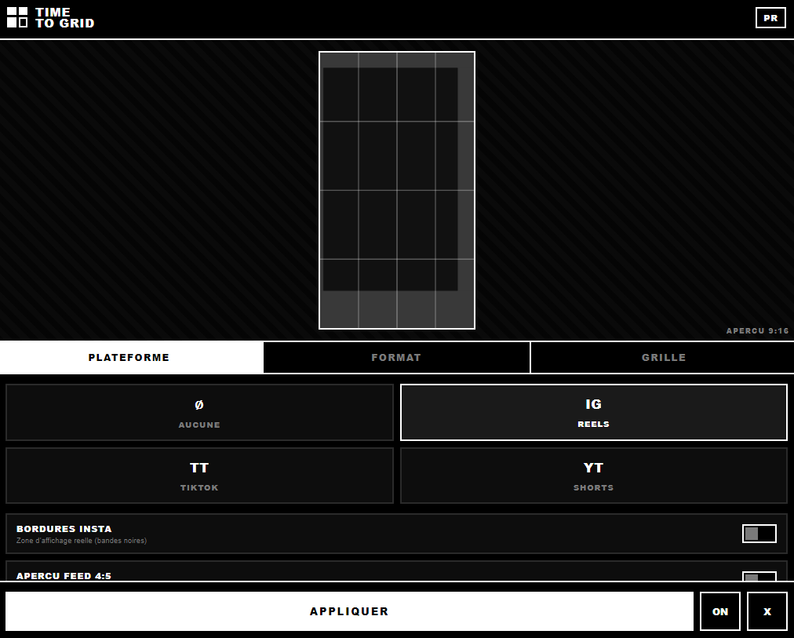

# Time to Grid

Social media safe zones and composition grids, right inside After Effects and Premiere Pro.

Free and open source. Made by an editor, for editors.



## Why

Every time I cut a Reel, a TikTok or a Short, I had to guess where the captions, the buttons and the username would land. Time to Grid shows you exactly what the app will hide, before you export.

## Features

- Live preview inside the panel
- Safe zones for Instagram Reels, TikTok and YouTube Shorts
- Real Instagram display borders and a 4:5 feed crop preview
- Grids for rule of thirds, center, quarters, golden ratio, diagonals, or your own up to 12x12
- Opacity slider, one click Apply, ON/OFF toggle and Clear

## How it works

**After Effects** gets a locked guide layer. Guide layers never render, so there is zero risk at export.

**Premiere Pro** gets a transparent PNG at the exact resolution of your sequence, placed on the top track in a TIME TO GRID bin. Hit X or OFF before you export.

## Install

Works on Mac and Windows, After Effects 2019+ and Premiere Pro 2019+.

### 1. Enable unsigned extensions (once)

Mac, in Terminal
```bash
defaults write com.adobe.CSXS.11 PlayerDebugMode 1
defaults write com.adobe.CSXS.12 PlayerDebugMode 1
killall cfprefsd
```

Windows, in PowerShell
```powershell
New-ItemProperty -Path "HKCU:\Software\Adobe\CSXS.11" -Name PlayerDebugMode -Value 1 -PropertyType String -Force
New-ItemProperty -Path "HKCU:\Software\Adobe\CSXS.12" -Name PlayerDebugMode -Value 1 -PropertyType String -Force
```

### 2. Copy the folder

Download the latest release, unzip it and put the `TimeToGrid` folder here

Mac
```
~/Library/Application Support/Adobe/CEP/extensions/
```
Windows
```
C:\Users\<you>\AppData\Roaming\Adobe\CEP\extensions\
```

### 3. Open it

Restart the app, then go to **Window > Extensions (Legacy) > Time to Grid**.

## Roadmap

- New interface with the visual identity of the upcoming tool suite
- More platforms and custom presets
- Signed ZXP installer

## Contributing

Issues and pull requests are welcome. If a safe zone looks off on your phone, open an issue with a screenshot, it helps a lot.

## About

Built by Tim Rougemont, interactive media designer and VFX creator from Switzerland. More on YouTube at [@Timemmyt](https://www.youtube.com/@Timemmyt).

Licensed under MIT.

Une version française des instructions est dans [docs/README_FR.md](docs/README_FR.md).
